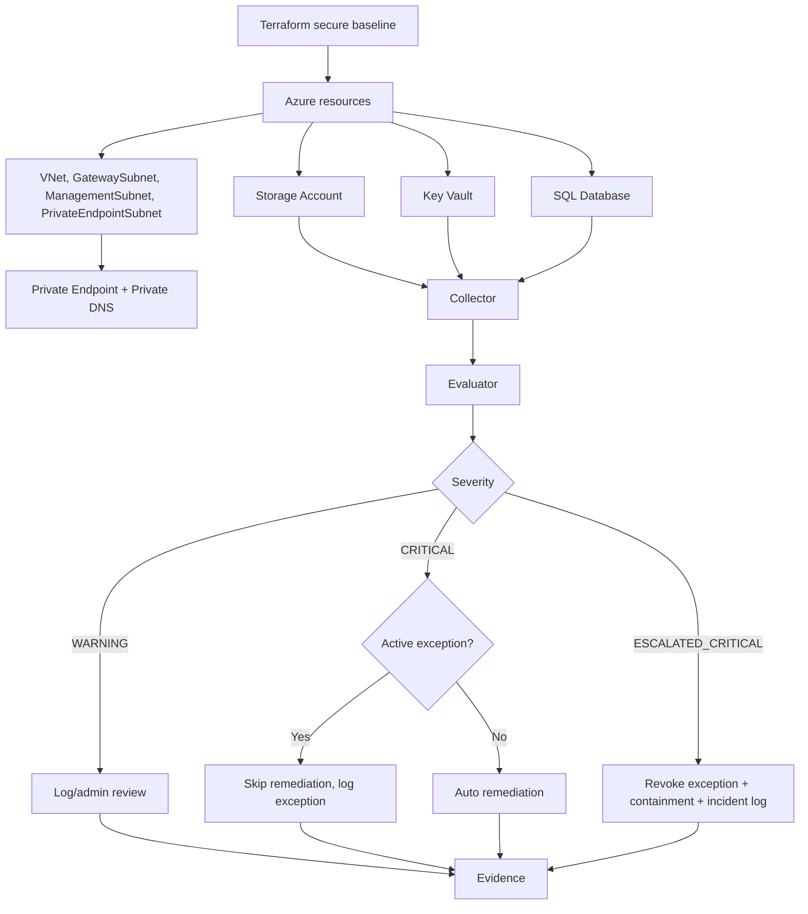

# PROJECT DEEP REVIEW - Azure Continuous Compliance & Auto-Remediation

> Tài liệu này là snapshot review trước P0. Trạng thái vận hành hiện tại nằm trong `README.md` và `docs/baseline.md`; Azure remediation hiện plan-only mặc định.

## 1. Executive Summary

Project NT542 xây dựng một mô hình Continuous Compliance và Auto-Remediation cho hệ thống lưu trữ dữ liệu nhạy cảm trên Microsoft Azure theo định hướng CIS Microsoft Azure Foundations Benchmark. Lõi kỹ thuật của project không chỉ là "dùng Azure", mà là biến secure baseline thành hạ tầng có thể tái tạo bằng Terraform, sau đó dùng Python Compliance Engine để kiểm tra trạng thái thực tế, phát hiện drift, phân loại severity, xử lý remediation, ghi log và tạo bằng chứng audit.

Hạ tầng được thiết kế theo hướng private-first: Storage Account, Key Vault và SQL được đặt sau Private Endpoint; admin truy cập qua Point-to-Site VPN và jumpbox trong ManagementSubnet. Đây là lựa chọn hợp lý vì dữ liệu nhạy cảm không nên phụ thuộc vào public endpoint, ngay cả khi đã có TLS và IAM.

Repo hiện tại có hai lớp tài liệu quan trọng: `README.md` mô tả phiên bản ban đầu tập trung vào Storage Account; `LOGIC_SUMMARY.md` và source code mới hơn thể hiện hệ thống đã mở rộng sang Key Vault, SQL, exception, incident escalation và containment. PDF final report 106 trang xác nhận kiến trúc tổng thể, workflow manual/automated, kịch bản demo và các hạn chế.

Điểm mạnh nhất của project là có logic vận hành thật: WARNING để log/admin review, CRITICAL để auto-remediate nếu không có exception, ESCALATED_CRITICAL để revoke exception và containment khi có security signal. Điểm yếu lớn nhất là vẫn ở lab scale, policy-as-code chưa thấy file triển khai trong repo, remediation còn dùng lệnh CLI trực tiếp, chưa có test suite, dashboard, scheduler và metadata approval đầy đủ.

Tài liệu này dùng project hiện tại làm nền tảng thiết kế lại một project cá nhân gọn hơn, chuyên nghiệp hơn và phù hợp portfolio DevOps/Cloud Security/Automation.

## 2. Source Inventory

| Nguồn | Loại | Nội dung chính | Độ tin cậy | Ghi chú |
|---|---|---|---|---|
| `[NT542.Q21] Final Report_Group8.pdf` | Final report | 106 trang: benchmark, manual/automated workflow, triển khai Azure, Terraform, Policy, engine, demo, hạn chế | Cao | Nguồn tổng hợp chính thức, cần đối chiếu với source |
| `README.md` | Tài liệu repo | Mô tả Storage compliance monitor, Terraform, Python, kịch bản WARNING/CRITICAL | Trung bình | Có dấu hiệu cũ hơn code hiện tại |
| `LOGIC_SUMMARY.md` | Ghi chú thiết kế | Kiến trúc private-first, exception, incident, severity 3 mức, log types | Cao | Khớp nhiều với code hiện tại |
| `Terraform/azure-secure-storage/*.tf` | IaC | Resource Group, VNet, subnet, Storage, Key Vault, SQL, Private Endpoint, DNS, LAW, VPN, jumpbox | Cao | 13 file Terraform |
| `Compliance/engine/*.py` | Python engine | Collector, evaluator, remediation, exception, incident, admin listener, audit logger | Cao | 11 file Python chính |
| `Compliance/data/exceptions.json` | Evidence/data | Exception đã tạo, expired/revoked, thời gian và lý do | Cao | Bằng chứng exception thực nghiệm |
| `Compliance/data/mock_storage.json` | Mock data | Trạng thái Storage vi phạm nhiều tiêu chí | Trung bình | Dữ liệu mẫu, không phải runtime Azure |
| `Compliance/engine/logs/*.log` | Evidence/log | Compliance, exception, incident và export logs | Cao | Bằng chứng runtime quan trọng |
| `Compliance/engine/requirements.txt` | Dependency | Azure SDK, dotenv, requests | Cao | Cho biết stack Python tối thiểu |
| Attachment prompt | Yêu cầu phân tích | Quy tắc review, cấu trúc file, các mục bắt buộc | Cao | Bị mojibake khi đọc, nhưng nội dung chính khôi phục được |

Số lượng nguồn đã đọc/đối chiếu: 40 nguồn chính, gồm PDF, 2 file Markdown, 13 file Terraform, 11 file Python, requirements, 2 file JSON data, 9 log/export log và prompt yêu cầu.

Nguồn chưa có / cần bổ sung:

- Chưa thấy chat transcript trong repo dưới các thư mục như `docs/context`, `chat_history`, `conversation_export`, `notes`, `prompts`.
- Chưa thấy file Azure Policy JSON/HCL riêng dù PDF mô tả Policy-as-Code.
- Chưa thấy CI/CD workflow, scheduler, dashboard, test suite, rollback script hoặc dry-run framework.
- Chưa thấy file `Compliance/data/security_signals.json` trong trạng thái hiện tại, dù PDF và code mô tả mock security signal.

## 3. Project Problem & Core Idea

Vấn đề cốt lõi là cấu hình cloud có thể đúng tại thời điểm triển khai nhưng sai lệch trong vận hành. Với dữ liệu nhạy cảm, các drift như bật Public Network Access, hạ TLS, tắt versioning hoặc thiếu Private Endpoint có thể tạo rủi ro bảo mật ngay cả khi hạ tầng ban đầu đã được harden.

Project giải quyết bài toán này bằng vòng lặp:

1. Terraform tạo desired state an toàn.
2. Azure Portal/Azure CLI tạo bằng chứng kiểm tra thủ công.
3. Python collector đọc actual state từ Azure SDK và Azure CLI.
4. Evaluator so sánh actual state với expected baseline.
5. Remediation xử lý theo severity và exception.
6. Audit logger ghi compliance, exception và incident evidence.

Manual vẫn cần tồn tại vì một số quyết định phụ thuộc ngữ cảnh: phê duyệt exception, đánh giá tác động remediation, xác minh DNS/Private Endpoint, IAM, chi phí Log Analytics và bằng chứng audit. Automated cần tồn tại vì manual không đủ nhanh, không lặp lại tốt và dễ bỏ sót khi tài nguyên tăng.

## 4. System Architecture

Terraform trong `Terraform/azure-secure-storage` tạo Resource Group, VNet, các subnet, Storage Account, Key Vault, SQL, Private Endpoint, Private DNS Zone, Log Analytics Workspace, Point-to-Site VPN và jumpbox. Engine trong `Compliance/engine/main.py` chạy vòng lặp định kỳ, mặc định 5 giây theo `config.py`, kiểm tra Storage, Key Vault và SQL.

Luồng truy cập private-first theo `LOGIC_SUMMARY.md`: admin workstation -> Point-to-Site VPN -> VNet `nt542-auto-vnet` -> jumpbox/management VM -> Storage/Key Vault/SQL qua Private Endpoint.

## 5. Toolchain Review

| Công cụ | Vai trò trong project | Vấn đề giải quyết | File/thư mục liên quan | Điểm mạnh | Hạn chế | Có nên tái sử dụng? |
|---|---|---|---|---|---|---|
| Azure Portal | Kiểm tra manual, cấu hình ban đầu, screenshot evidence | Xác minh trực quan và audit | PDF chương 2-3 | Dễ audit, dễ chứng minh | Không scale, dễ thao tác thiếu | Có, cho demo/audit |
| Azure CLI | Thu thập config và remediation | Truy vấn JSON, đổi cấu hình nhanh | `collector.py`, `remediation.py`, `incident_response.py` | Scriptable, rõ bằng chứng | Lệnh shell trực tiếp cần kiểm soát lỗi tốt hơn | Có, nhưng cần wrapper an toàn |
| Terraform | IaC secure baseline | Tái tạo hạ tầng nhất quán | `Terraform/azure-secure-storage` | Baseline rõ, versionable | Chưa module hóa, còn secrets output sensitive | Có, nên refactor module |
| Azure Policy | Guardrail nền tảng | Audit/deny cấu hình sai | PDF trang 20, 78-79 | Phù hợp governance | Chưa thấy policy file trong repo | Có, cần bổ sung source |
| Python | Compliance engine | Collector/evaluator/remediation loop | `Compliance/engine` | Linh hoạt, dễ demo | Chưa có test, rule hard-code | Có, nên viết lại sạch hơn |
| Log Analytics Workspace | Tập trung log Azure | Audit/monitoring | `monitoring.tf`, PDF | Phù hợp điều tra | Engine log local nhiều hơn LAW | Có, cần tích hợp sâu hơn |
| Diagnostic Settings | Đẩy log Azure | Evidence và monitoring | `monitoring.tf` | Có Storage/VNet diag | Chưa thấy Key Vault/SQL diag trong Terraform hiện tại | Có, cần mở rộng |
| pypdf/PDF report | Review tài liệu | Đối chiếu báo cáo với code | PDF | Có bối cảnh đầy đủ | Không thay thế source evidence | Không phải runtime component |

## 6. Azure Resource Baseline

Terraform baseline:

| Tài nguyên | File | Cấu hình chính | Nhận xét kỹ thuật |
|---|---|---|---|
| Resource Group | `main.tf` | `NT542-Group08_AUTO` mặc định | Tách môi trường lab rõ |
| VNet/Subnet | `network.tf`, `variables.tf` | `10.1.0.0/16`, `GatewaySubnet`, `ManagementSubnet`, `PrivateEndpointSubnet` | Đúng hướng private-first; Private Endpoint subnet disable network policies |
| Storage Account | `storage.tf` | HTTPS only, TLS 1.2, public network disabled, anonymous blob disabled, infra encryption, soft delete, versioning, default deny | Phủ tốt nhóm Storage CIS |
| Blob Private Endpoint/DNS | `private_endpoint.tf` | `privatelink.blob.core.windows.net`, subresource `blob` | Đúng mô hình private endpoint |
| Key Vault | `key_vault.tf` | RBAC, purge protection, public access disabled, network ACL deny, Private Endpoint | Tốt cho secrets, nhưng chưa thấy keys/secrets mẫu trong Terraform |
| SQL | `sql.tf` | TLS 1.2, public access disabled, Entra-only admin, auditing, Defender, Private Endpoint | Baseline tốt; Defender dùng pricing `SqlServers` cần kiểm tra scope subscription |
| Monitoring | `monitoring.tf` | LAW, StorageRead/Write/Delete, VNet metric/log | Chưa thấy diagnostic setting Terraform cho Key Vault/SQL dù PDF có nêu |
| VPN/Jumpbox | `vpn_gateway.tf`, `vm_jumpbox.tf` | P2S OpenVPN, VM không public IP, SSH từ VPN pool | Hợp lý cho private admin access; lab cost và certificate management cần chú ý |

## 7. Manual Compliance Workflow

Manual workflow trong PDF gồm Azure Portal, Azure CLI, đối chiếu PASS/FAIL và lưu evidence. Manual phù hợp cho:

- Xác minh public access, TLS, HTTPS, soft delete, versioning, network rules.
- Kiểm tra Private Endpoint/DNS bằng quan sát thực tế và truy vấn CLI.
- Phê duyệt exception/remediation khi thay đổi có thể gây gián đoạn.
- Chuẩn bị bằng chứng audit dạng screenshot, output lệnh và bảng tổng hợp.

Hạn chế của manual:

- Không giám sát liên tục.
- Không phản ứng nhanh với drift.
- Dễ bỏ sót các cờ nhỏ như cross-tenant replication, infrastructure encryption, container soft delete.
- Phụ thuộc kỹ năng người vận hành.

Kết luận: manual không nên bị bỏ, nhưng chỉ nên dùng để xác minh, phê duyệt, audit và xử lý ngữ cảnh. Continuous monitoring nên do automated workflow đảm nhiệm.

## 8. Automated Compliance Workflow

Automated workflow hiện thực trong repo:

1. `main.py` định nghĩa expected baseline cho Storage, Key Vault, SQL.
2. `collector.py` dùng Azure SDK cho Storage và Azure CLI cho Key Vault/SQL/private endpoint.
3. `evaluator.py` so sánh actual với expected, gán severity.
4. `incident_evaluator.py` đọc security signals và tạo issue `ESCALATED_CRITICAL` nếu untrusted source thực hiện sensitive operation thành công.
5. `remediation.py` xử lý WARNING/CRITICAL/ESCALATED_CRITICAL.
6. `exception_manager.py` cho phép exception có thời hạn.
7. `incident_response.py` revoke exception và containment.
8. `audit_logger.py` ghi compliance, exception, incident log và export log.
9. `admin_listener.py` hỗ trợ `/exception` và `/getlog`.

Severity model:

| Severity | Ý nghĩa | Ví dụ | Xử lý |
|---|---|---|---|
| WARNING | Drift cần admin review | Blob versioning disabled, missing key/secret expiry, SQL AD admin missing | Log/report, không auto mạnh |
| CRITICAL | Drift nguy hiểm có thể sửa tương đối an toàn | Public Network Access enabled, TLS mismatch, SQL auditing disabled | Auto-remediate nếu không có exception |
| ESCALATED_CRITICAL | Có dấu hiệu sự cố, không chỉ drift | GetBlob success từ untrusted source | Revoke exception, containment, incident log |

## 9. CIS Control Mapping

| Nhóm | Tiêu chí/CIS | Azure resource | Cấu hình mong muốn | Manual kiểm tra | Automated kiểm tra | Remediation | Ghi chú |
|---|---|---|---|---|---|---|---|
| Storage | Secure transfer/HTTPS only | Storage | `https_traffic_only_enabled=true` | Portal/CLI account show | `collector.py` + `evaluate_config` | Có | CRITICAL |
| Storage | Minimum TLS | Storage | `TLS1_2` | Portal/CLI | `min_tls_version` | Có | CRITICAL |
| Storage | Public Network Access | Storage | `Disabled` | Networking tab/CLI | `public_network_access` | Có | CRITICAL, có exception |
| Storage | Default Network Access | Storage | `Deny` | CLI network rules | Terraform `network_rules` | Chưa thấy rule engine riêng | Cần bổ sung collector |
| Storage | Anonymous access | Storage | Disabled | Portal/CLI | Terraform có baseline | Chưa thấy collector kiểm tra | Gap giữa Terraform và engine |
| Storage | Blob soft delete | Blob service | Enabled, 7 days | Portal/CLI | Terraform có baseline | Chưa thấy engine check | Gap |
| Storage | Container soft delete | Blob service | Enabled, 7 days | Portal/CLI | Terraform có baseline | Chưa thấy engine check | Gap |
| Storage | Blob versioning | Blob service | Enabled | Portal/CLI | `versioning_enabled` | Có command nhưng WARNING hiện chỉ log | Có thể đổi thành approval mode |
| Storage | Infrastructure encryption | Storage | Enabled | Portal/CLI | Terraform có baseline | Chưa thấy engine check | Gap |
| Storage | Cross-tenant replication | Storage | Disabled | Portal/CLI | PDF nêu | Chưa thấy Terraform/code explicit | Cần xác minh |
| Key Vault | Soft delete | Key Vault | Enabled | Portal/CLI | `collect_key_vault_config` | Một phần | CRITICAL recoverability |
| Key Vault | Purge protection | Key Vault | Enabled | Portal/CLI | `enable_purge_protection` | Có command | Bật purge protection không revert được dễ dàng |
| Key Vault | RBAC authorization | Key Vault | Enabled | Portal/CLI | `enable_rbac_authorization` | Có | Cần kiểm tra tác động access policy |
| Key Vault | Public access | Key Vault | Disabled | Portal/CLI | `public_network_access` | Có | CRITICAL |
| Key Vault | Private Endpoint | Key Vault | Approved PE | Private endpoint connections | `_has_private_endpoint` | Chưa có auto command | Manual nếu missing |
| Key Vault | Expiry keys/secrets | Keys/secrets | Có expiration | Portal/CLI list | `keys_have_expiry`, `secrets_have_expiry` | Chưa có | WARNING |
| SQL | Auditing | SQL Server | Enabled | Portal/CLI audit-policy | `auditing_enabled` | Có | CRITICAL |
| SQL | Defender for SQL | SQL | Standard | Defender portal/CLI | `security pricing show SqlServers` | Có | Scope subscription cần chú ý |
| SQL | Minimum TLS | SQL Server | `1.2` | Portal/CLI | `min_tls_version` | Có | CRITICAL |
| SQL | Public access | SQL Server | Disabled | Portal/CLI | `public_network_access` | Có | CRITICAL |
| SQL | Entra-only auth | SQL Server | AD admin configured/auth only | Portal/CLI | `azure_ad_admin_configured` | Chưa có | Engine chưa kiểm tra auth-only trực tiếp |
| SQL | Private Endpoint | SQL Server | Approved PE | Portal/CLI | `_has_private_endpoint` | Chưa có | Manual |
| Network | VNet/subnets | Network | Tách gateway, management, private endpoint | Portal/CLI | Terraform baseline | Không áp dụng | Manual/architecture |
| Network | Private DNS Zone | DNS | Blob, Vault, SQL zones linked VNet | Portal/CLI | Terraform baseline | Không áp dụng | Engine chưa check DNS |

## 10. Code & Module Review

| Module | Vai trò | Input | Output | Nhận xét và khả năng tái sử dụng |
|---|---|---|---|---|
| `collector.py` | Thu thập actual state | Azure SDK creds, Azure CLI, resource names | Dict config và security signals | Tái sử dụng tốt, nhưng nên tách Azure SDK/CLI adapter và chuẩn hóa error handling |
| `evaluator.py` | Rule engine hard-code | Actual/expected config | List issue + severity | Dễ hiểu cho lab; project cá nhân nên chuyển rules sang YAML/JSON |
| `incident_evaluator.py` | Nhận diện sensitive success từ untrusted source | Signal list | ESCALATED_CRITICAL issues | Logic đúng hướng: không escalate chỉ vì IP lạ, cần success + operation nhạy cảm |
| `remediation.py` | Xử lý issue theo severity | Resource group/name/issues | CLI remediation/log | Có giá trị demo; cần dry-run, approval metadata, timeout, structured result |
| `incident_response.py` | Containment sự cố | Incident issue | Revoke exception, disable public access, incident log | Tốt cho narrative security; cần playbook theo service và hậu kiểm |
| `exception_manager.py` | Quản lý exception có thời hạn | Exception command/options | JSON exceptions, status active/expired/revoked | Có nền tốt; thiếu approved_by, owner, ticket, scope, risk acceptance |
| `audit_logger.py` | Ghi và export log | Event fields | `.log` files | Tốt cho demo; nên chuẩn hóa JSONL hoặc schema |
| `admin_listener.py` | Command loop | `/exception`, `/getlog` | Tạo exception/export logs | Hữu ích trong demo local; production nên thay bằng API/CLI rõ quyền |
| `main.py` | Orchestrator loop | Config/env | Continuous scan | Dễ chạy; cần graceful shutdown, scheduler, retry/backoff |
| `config.py` | Env/default config | `.env`/env vars | Constants | Có default tốt; cần secret hygiene và validation |
| `logger.py` | Logger cũ | Message | `logs/compliance_monitor.log` | Có vẻ legacy, trùng phần với `audit_logger.py` |

Terraform review:

| File | Vai trò | Điểm mạnh | Điểm cần cải thiện |
|---|---|---|---|
| `provider.tf` | Provider azurerm/random | Pin provider rõ | Chưa tách backend state |
| `variables.tf` | Tham số | Defaults đầy đủ | Có biến `vpn_client_root_certificate_data` sensitive nhưng cần hướng dẫn secret injection |
| `main.tf` | Resource group | Đơn giản | Data resource tham chiếu RG vừa tạo hơi dư |
| `network.tf` | VNet/subnets | Phân tách subnet tốt | Chưa thấy NSG cho PrivateEndpointSubnet/ManagementSubnet ngoài jumpbox |
| `storage.tf` | Storage hardening | Phủ HTTPS/TLS/public/soft delete/versioning/infra encryption/default deny | Shared key vẫn enabled; cross-tenant replication chưa thấy explicit |
| `private_endpoint.tf` | Blob PE/DNS | Đúng subresource blob | Chưa check DNS bằng test |
| `key_vault.tf` | Key Vault + PE | RBAC, purge, public disabled | Chưa tạo keys/secrets mẫu có expiry |
| `sql.tf` | SQL + PE | TLS, Entra admin, auditing, Defender | Defender pricing scope cần cân nhắc; password output sensitive |
| `monitoring.tf` | LAW + diagnostics | Có Storage/VNet logs | Chưa thấy Key Vault/SQL diagnostics như PDF nêu |
| `vpn_gateway.tf` | P2S VPN | Đúng private admin pattern | Chi phí và certificate lifecycle cần docs |
| `vm_jumpbox.tf` | Management VM | Không public IP, SSH từ VPN pool | Password auth enabled, production nên dùng SSH key/AAD |
| `outputs.tf` | Outputs | Đủ thông tin vận hành | Có output password sensitive; cần state protection |

## 11. Demo Scenarios & Evidence

| Kịch bản | Drift được tạo | Mức độ | Engine phát hiện | Remediation | Evidence/log | Nhận xét |
|---|---|---|---|---|---|---|
| Blob Versioning disabled | Tắt versioning | WARNING | `Blob versioning disabled` | Log/admin review | `compliance_monitor.log` có `WARNING_DETECTED` | Phù hợp cảnh báo, nhưng có command bật lại trong remediation map |
| Public Network Access enabled | Bật public access Storage | CRITICAL | `Public Network Access mismatch` | Auto disable public access | Log có `CRITICAL_DETECTED` và `AUTO_REMEDIATION_SUCCESS` | Demo mạnh nhất |
| CRITICAL + active exception | Tạo `/exception`, bật public access | CRITICAL | Engine thấy drift nhưng có exception | Skip remediation | `exceptions.log` có `REMEDIATION_SKIPPED` | Hợp lý cho test có kiểm soát |
| Exception hết hạn | Drift còn tồn tại sau expiry | CRITICAL | Exception expired | Auto-remediate | PDF trang 96-97, log runtime | Cần thêm hậu kiểm structured |
| ESCALATED_CRITICAL | Public access + GetBlob success từ untrusted IP | ESCALATED_CRITICAL | `Storage sensitive access from untrusted source` | Revoke exception + containment | `incidents.log`, `exceptions.json` revoked | Thiết kế tốt: exception không che incident |
| Key Vault/SQL compliant scan | Không drift ở cuối log | PASS | `Key Vault ... is compliant`, `SQL Server ... is compliant` | Không cần | Tail log ngày 2026-06-02 | Có scan, nhưng demo drift chủ yếu Storage |

## 12. Design Decisions Extracted from Reports/Chats

Quyết định thiết kế rút ra từ PDF, README, LOGIC_SUMMARY và code:

- Chọn Continuous Compliance thay vì checklist tĩnh vì cloud drift xảy ra sau deployment.
- Chọn private-first để giảm bề mặt tấn công public endpoint.
- Kết hợp manual và automated thay vì thay thế hoàn toàn manual.
- Chọn Terraform để tạo desired state ban đầu.
- Dùng Azure CLI/Azure SDK để đọc actual state và thực thi remediation.
- Phân loại severity theo WARNING/CRITICAL/ESCALATED_CRITICAL.
- Cho phép exception có thời hạn để hỗ trợ kiểm thử vận hành.
- Không cho exception che giấu incident; incident sẽ revoke exception và containment.
- Tách log compliance, exception, incident để phục vụ audit.

Không có chat transcript để đối chiếu quyết định hội thoại. Không tự bịa nội dung chat.

Mâu thuẫn/chênh lệch giữa báo cáo và source:

| Chủ đề | Báo cáo nói gì | Code/thực tế thể hiện gì | Nhận xét kỹ thuật | Cần xác minh thêm |
|---|---|---|---|---|
| Azure Policy | Có Policy-as-Code, bảng policy | Không thấy file policy JSON/HCL trong repo | Có thể đã làm ngoài repo hoặc chỉ mô tả báo cáo | Bổ sung `policies/` |
| Key Vault/SQL diagnostics | PDF nêu Diagnostic Settings cho nhiều dịch vụ | Terraform hiện thấy Storage/VNet diag rõ, chưa thấy Key Vault/SQL diag | Coverage monitoring chưa đồng đều | Thêm diag cho KV/SQL |
| Cross-tenant replication | PDF nói disabled | `storage.tf` chưa thấy explicit field | Có thể default hoặc thiếu | Kiểm tra provider support |
| Reporting JSON/HTML | PDF nêu báo cáo định kỳ | Repo hiện chủ yếu log/export log | Reporter chưa tách module rõ | Bổ sung report generator |
| Approval mode | PDF nói Safe/Approval/Auto Mode | Code có WARNING log, CRITICAL auto, exception command; approval metadata chưa đủ | Approval còn sơ khai | Thêm workflow approve |

## 13. Strengths

- Kiến trúc private-first rõ, có VNet, Private Endpoint, Private DNS, VPN và jumpbox.
- Terraform baseline phủ Storage, Key Vault, SQL ở mức lab tốt.
- Engine có collector/evaluator/remediation pattern dễ hiểu.
- Severity model có chiều sâu hơn checker thông thường nhờ `ESCALATED_CRITICAL`.
- Exception có thời hạn và có trạng thái expired/revoked.
- Incident có logic revoke exception và containment.
- Evidence log khá đầy đủ cho demo: compliance, exception, incident, export logs.
- PDF ghi nhận hạn chế khá thật, không chỉ quảng bá kết quả.

## 14. Limitations & Risks

Hạn chế:

- Lab scale, chưa multi-subscription/multi-resource-group.
- Policy-as-Code chưa có source trong repo.
- Rule engine hard-code, khó mở rộng rule CIS.
- Remediation từng dùng `subprocess.run(..., shell=True)` và lệnh string. P0 đã chuyển sang argument vector, timeout và plan-only mặc định; approval/verification đầy đủ vẫn còn trong roadmap.
- Chưa có dry-run, rollback, impact analysis.
- Exception thiếu `approved_by`, owner, ticket, risk acceptance, affected scope.
- Chưa có dashboard trực quan.
- Chưa có CI/CD scheduled compliance scan.
- Chưa có test suite.
- Key Vault/SQL có collector/evaluator nhưng demo drift/remediation chưa sâu bằng Storage.
- Engine log local nhiều; tích hợp Log Analytics cho engine event chưa rõ.

Rủi ro vận hành:

- Auto-remediation có thể làm gián đoạn nếu admin mở tạm public access để xử lý sự cố kết nối.
- Policy deny có thể chặn deployment hợp lệ nếu không có exemption process.
- Exception có thể bị lạm dụng nếu không cần approver và ticket.
- Service principal/environment secrets có nguy cơ lộ nếu `.env` bị commit hoặc chia sẻ.
- Log Analytics có thể tăng chi phí nếu bật nhiều category không kiểm soát retention.
- DNS/Private Endpoint sai có thể làm dịch vụ "an toàn" nhưng không truy cập được.
- Azure Policy audit không thay runtime monitoring.
- Polling interval 5 giây tốt cho demo nhưng có thể tốn API quota/log trong production.
- RBAC cho engine nếu quá rộng sẽ tạo blast radius lớn.

## 15. Lessons Learned

- Secure baseline chỉ là điểm bắt đầu; điều quan trọng là duy trì baseline sau khi có drift.
- Private-first cần đi kèm DNS, VPN/jumpbox và quy trình vận hành, không chỉ tắt public access.
- Manual và automated bổ sung cho nhau: manual xác minh ngữ cảnh, automated đảm bảo tốc độ và lặp lại.
- Exception cần có giới hạn thời gian và không được che incident.
- Severity nên phân biệt drift cấu hình với security signal thực tế.
- Evidence-first design làm project dễ bảo vệ khi phỏng vấn vì có log và kịch bản cụ thể.

## 16. Reusable Components for Personal Project

| Thành phần | Có tái sử dụng không | Lý do | Cần chỉnh gì |
|---|---|---|---|
| Private-first Terraform baseline | Có | Có giá trị cloud security rõ | Module hóa, thêm backend, variable hygiene |
| Storage hardening | Có | Phủ nhiều CIS quan trọng | Thêm cross-tenant replication check |
| Key Vault/SQL baseline | Có | Mở rộng scope tốt | Thêm diagnostics, sample keys/secrets expiry |
| Collector/evaluator pattern | Có | Dễ chuyển thành product nhỏ | Tách interface, typed models |
| Severity model 3 mức | Có | Có chiều sâu kỹ thuật | Viết policy rõ cho từng severity |
| Exception manager | Có | Demo operational realism | Thêm approver/ticket/owner |
| Incident escalation | Có | Điểm portfolio nổi bật | Tích hợp Azure logs thật thay mock |
| Admin listener | Một phần | Tốt cho demo CLI | Thay bằng CLI subcommands/API |
| Local logs/export logs | Có | Evidence hữu ích | Chuyển JSONL/schema/report |
| Current README | Viết lại | Cũ hơn code | Đồng bộ kiến trúc mới |

## 17. Personal Project Directions

### 17.1. Azure Continuous Compliance Mini Platform

- Mục tiêu: Mini platform kiểm tra CIS cho Storage, Key Vault, SQL trên một resource group.
- MVP: Terraform baseline, YAML rules, scan command, JSON/HTML report, dry-run remediation.
- Tech stack: Terraform, Python, Azure SDK/CLI, GitHub Actions, Markdown report.
- Kiến trúc: IaC -> scan -> evaluate -> report -> optional remediation.
- Demo: bật public access, tắt versioning, thiếu expiry secret.
- CV highlight: "Built Azure continuous compliance scanner with drift detection and controlled remediation."
- Độ khó: Trung bình.
- Thời gian: 3-5 tuần.

### 17.2. Multi-cloud Compliance Rule Engine

- Mục tiêu: Rule engine chung cho Azure/AWS/GCP ở mức cấu hình.
- MVP: YAML rules, adapters Azure/AWS, generic evaluator, report.
- Tech stack: Python, Pydantic, boto3, Azure SDK, pytest.
- Kiến trúc: provider adapter -> normalized resource model -> rule evaluator.
- Demo: Azure Storage public access và AWS S3 public bucket.
- CV highlight: "Designed provider-agnostic compliance engine."
- Độ khó: Cao.
- Thời gian: 6-10 tuần.

### 17.3. Policy Drift Detection & Remediation Dashboard

- Mục tiêu: Dashboard theo dõi drift, severity, remediation history.
- MVP: scanner, SQLite/Postgres, API, dashboard, charts.
- Tech stack: Python/FastAPI, React, Terraform, Azure SDK, Docker.
- Kiến trúc: scheduler -> scans -> DB -> dashboard -> remediation action.
- Demo: trend compliance score, incident timeline, exception expiry.
- CV highlight: "Built dashboard-driven cloud policy drift detection and remediation workflow."
- Độ khó: Cao vừa.
- Thời gian: 5-8 tuần.

Đề xuất tốt nhất cho portfolio DevOps/Cloud Security/Automation: Azure Continuous Compliance Mini Platform. Hướng này bám sát project hiện tại, đủ sâu để thể hiện cloud security, nhưng không quá rộng như multi-cloud. Sau khi hoàn thiện MVP, có thể nâng cấp thêm dashboard như phase sau.

## 18. Recommended Personal Project Blueprint

Tên đề xuất: `azure-compliance-guard`.

MVP scope:

- Azure Storage, Key Vault, SQL trong một resource group.
- Terraform baseline private-first.
- Rule definitions bằng YAML/JSON.
- Scanner CLI: `scan`, `report`, `remediate --dry-run`, `remediate --apply`.
- Exception file có owner, approver, ticket, reason, expiry.
- Report JSON + Markdown/HTML.
- GitHub Actions scheduled scan.

Module blueprint:

| Module | Nhiệm vụ |
|---|---|
| `iac/` | Terraform baseline module |
| `rules/` | YAML rules mapping CIS/control |
| `src/adapters/azure.py` | Thu thập actual state |
| `src/evaluator.py` | Generic rule evaluation |
| `src/remediation/` | Remediation commands with dry-run |
| `src/exceptions.py` | Exception validation/expiry |
| `src/reporters/` | Markdown/JSON/HTML report |
| `.github/workflows/scan.yml` | Scheduled scan |
| `docs/` | Architecture, demo, runbook |

Demo chính:

1. Deploy baseline.
2. Scan PASS.
3. Tạo drift public access.
4. Scan FAIL CRITICAL.
5. Dry-run remediation.
6. Apply remediation.
7. Tạo exception có ticket.
8. Hết exception thì fail/remediate.
9. Sinh report và evidence.

## 19. Development Roadmap

| Phase | Mục tiêu | Deliverables | Tiêu chí hoàn thành | Rủi ro | Output nên commit |
|---|---|---|---|---|---|
| 1. Repository cleanup + documentation | Làm sạch scope cá nhân | README, architecture, threat model | Người đọc hiểu trong 5 phút | Scope quá rộng | `README.md`, `docs/architecture.md` |
| 2. Terraform baseline | Tạo Azure lab an toàn | Terraform modules | Apply tạo Storage/KV/SQL private-first | Cost/VPN phức tạp | `iac/` |
| 3. Rule engine chuẩn hóa | Tách rule khỏi code | YAML rules, evaluator | Thêm rule không sửa evaluator | Schema kém | `rules/`, `src/evaluator.py` |
| 4. Drift detection + report | Scan actual state | JSON/Markdown report | Có PASS/FAIL/severity/evidence | Azure API lỗi | `src/reporters/` |
| 5. Remediation dry-run/auto/manual | Sửa có kiểm soát | Dry-run/apply/approval | Không apply nếu chưa approve | Gây gián đoạn | `src/remediation/` |
| 6. Dashboard/logging | Quan sát kết quả | JSONL/SQLite/dashboard optional | Xem lịch sử scan | Quá nhiều UI | `dashboard/` hoặc `reports/` |
| 7. CI/CD scheduled scan | Chạy định kỳ | GitHub Actions | Scan theo schedule và artifact report | Secret management | `.github/workflows/scan.yml` |
| 8. Demo, README, diagram, portfolio | Đóng gói | Demo script, screenshots, CV bullets | Người phỏng vấn chạy theo được | Thiếu evidence | `docs/demo.md`, `docs/portfolio.md` |

## 20. Portfolio/CV Positioning

DevOps/Cloud Security bullets:

- Designed and implemented an Azure continuous compliance lab using Terraform, Private Endpoints, Private DNS, Key Vault, SQL Database and Log Analytics.
- Built a Python compliance engine to collect Azure resource state, evaluate CIS-aligned controls, detect drift and generate audit evidence.
- Implemented severity-based remediation logic with WARNING, CRITICAL and ESCALATED_CRITICAL workflows.
- Added time-bound security exceptions with automatic expiry and incident-driven revocation.
- Demonstrated controlled auto-remediation for public network exposure and incident containment for sensitive access from untrusted sources.
- Documented manual vs automated compliance workflows, operational risks and roadmap for production hardening.

## 21. Open Questions / Missing Evidence

- Azure Policy source nằm ở đâu? Repo hiện chưa có `policies/` hoặc policy assignment HCL/JSON.
- Có sử dụng Terraform remote state/backend không?
- Có file dashboard hoặc report generator JSON/HTML nào ngoài log export không?
- `security_signals.json` được tạo trong demo nhưng hiện không tồn tại trong `Compliance/data`.
- Engine có cần kiểm tra Storage soft delete, container soft delete, infrastructure encryption, cross-tenant replication ở runtime không?
- Key Vault/SQL drift scenarios đã chạy thực tế đến mức nào ngoài compliant scan?
- Có yêu cầu production về retention, alert routing, RBAC least privilege và cost control không?
- Có nên thay shell command remediation bằng Azure SDK để giảm rủi ro command injection và lỗi quoting không?
- Có cần scheduler GitHub Actions/Azure Functions/Azure Automation cho compliance loop không?
- Chat transcript chưa có, nên chưa thể trích xuất các quyết định thiết kế từ hội thoại.

## Terminal Summary

- Đường dẫn file đã tạo: `docs/PROJECT_DEEP_REVIEW.md`
- Số lượng nguồn đã đọc: 40 nguồn chính.
- Các phần còn thiếu bằng chứng: chat transcript, Azure Policy source, dashboard, CI/CD scheduler, test suite, rollback/dry-run, full Key Vault/SQL drift demo, runtime checks cho một số Storage controls.
- 5 insight kỹ thuật quan trọng nhất:
  1. Project có giá trị nhất ở vòng lặp duy trì compliance sau deploy, không chỉ ở Terraform baseline.
  2. Private-first chỉ hoàn chỉnh khi đi cùng VPN/jumpbox, Private DNS, Private Endpoint và operational runbook.
  3. Exception có thời hạn là cần thiết cho vận hành, nhưng phải bị revoke khi có incident signal.
  4. Báo cáo mô tả Azure Policy rộng hơn bằng chứng trong repo; cần bổ sung policy source để tăng độ tin cậy portfolio.
  5. Phiên bản project cá nhân nên giữ kiến trúc và severity model, nhưng viết lại rule/remediation/report theo hướng có schema, dry-run, tests và CI/CD.
