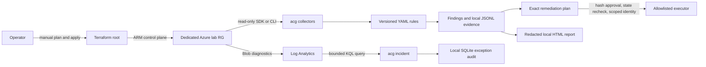

# Architecture and deployment profiles

The installable `acg` CLI collects Azure configuration, evaluates versioned YAML rules, writes local evidence, and prepares controlled remediation. The older `Compliance/engine` monitor remains for compatibility; it is plan-only. See [Phase F status](phase-f-status.md), [Phase I status](phase-i-status.md), and [Phase H status](phase-h-status.md) for tested boundaries.

## Deployment boundary

`Terraform/azure-minimal-storage` is the default Phase K demo profile: one new dedicated resource group, a Standard LRS Storage account, a Log Analytics workspace, and Blob diagnostic settings. The Storage public endpoint is disabled and no Private Endpoint is provisioned, so Blob data-plane operations from a laptop are unavailable by default. ARM configuration reads still demonstrate drift detection. Incident behavior can be shown with a labeled fixture; a real Blob-log demo needs a separately reviewed private-network path and an actual ingested event.

`Terraform/azure-secure-storage` is the existing full-demo root. It includes Key Vault, SQL, private networking, VPN and a jumpbox. It is not a cheap default. The roots have separate state keys and resource groups. Moving existing resources between them needs a deliberate Terraform state migration; simply switching directories cannot reassign ownership. The full root may hold existing state, so Phase K does not change its resource addresses.

The Azure state container is a separate trust boundary. Its blob can contain sensitive resource values and must be private, access-controlled, backed up and never committed. The GitHub manual plan workflow currently targets only the full root and never applies. The Phase K minimal path is a manual operator workflow described in [demo.md](demo.md).

## Data and trust boundaries

1. Terraform input, the selected Azure subscription and backend key cross from the operator machine into Azure. The operator checks the subscription, dedicated RG name, state key and plan before every mutation.
2. Azure SDK/CLI and Log Analytics results are external input. Collectors normalize them; rules and scan outputs do not grant Azure write permission.
3. YAML rules, local SQLite exception records, JSON plans and approvals can be modified by local users. Rule schema checks, hash checks and full before-state re-collection limit mistakes but do not authenticate a human or make updates atomic.
4. Raw JSONL evidence, SQLite state, Terraform state and operational reports stay in private local storage. HTML rendering redacts fields, but a report is only a view of supplied evidence, not proof of authenticity.

## Guarantees and limits

Offline PR CI has no Azure credentials and never runs `apply` or `destroy`. The CLI defaults to plan-only; live remediation needs an exact plan/approval, non-stale state, an initialized exception DB, an explicit mutation flag and narrow Azure RBAC. Incident detection proposes containment; it does not directly mutate Azure. The Phase K live deployment and cleanup checkpoint remains open until recorded against a real subscription.
